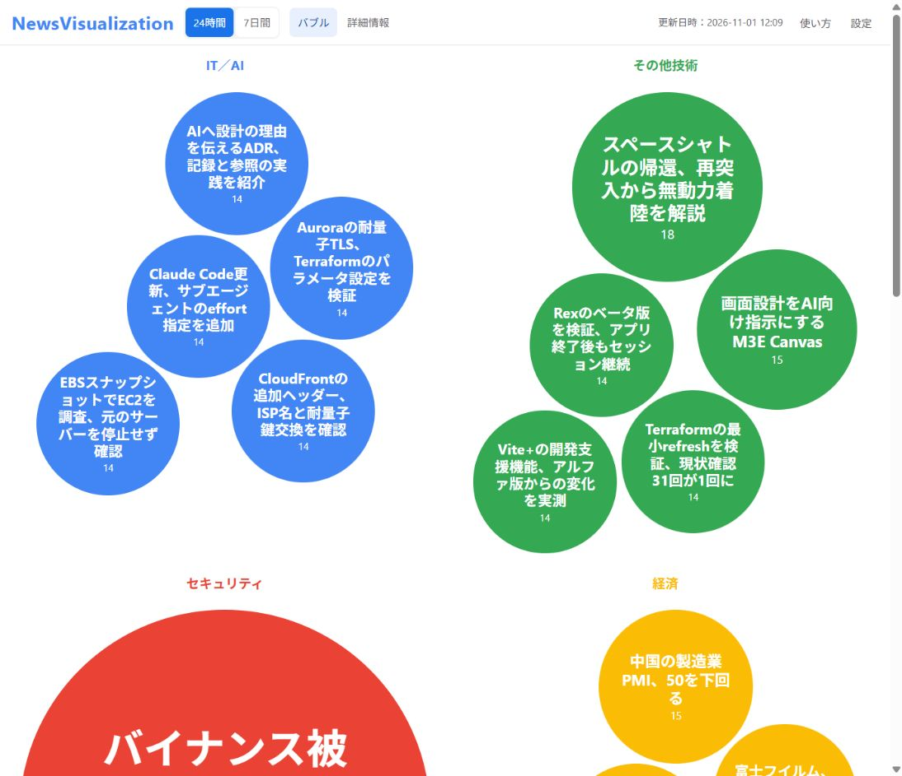

# NewsVisualization



ニュースを分野別のバブルで表示し、話題度・要約・出典を確認するアプリです。ニュースの収集・更新はCodexへ依頼します。

画面操作は、起動後の[使い方](http://127.0.0.1:8767/#help)を開いてください。

## 1. ローカルで使う

### 初回セットアップ（Windows）

1. [Python公式のWindows版](https://www.python.org/downloads/windows/)をインストールする。導入済みなら、PowerShellで `python --version` を実行し、3.10以降であることを確認する。
2. このページの「Code」→「Download ZIP」でダウンロードし、好きな場所に展開する。
3. 展開したフォルダー（`start.ps1`がある場所）を開き、アドレスバーへ `powershell` と入力してEnterを押す。
4. ニュースを更新する場合は、ログイン済みのCodexデスクトップアプリで同じフォルダーを開く。

ローカル起動に追加パッケージやNode.jsは不要です。

### 起動する

1. PowerShellで実行する。

```powershell
.\start.ps1
```

2. 起動したPCで、[http://127.0.0.1:8767/](http://127.0.0.1:8767/) を開く。
3. 画面の「設定」で収集分野・注目サイト・倍率を調整する。
4. 終了するときは、PowerShellで `Ctrl+C` を押す。

`.ps1`を実行できない場合は、同じフォルダーで `python -B server.py --port 8767` を実行してください。

### ニュースを更新する

Codexへ貼り付け、完了後に画面の「更新日時」を確認します。

```text
このプロジェクトのnv-news-researchを実行し、ニュースJSONを更新してください。
```

### 定期更新を設定する

手動更新が成功したら、時刻を書き換え、同じローカルCodexのチャットへ貼り付けます。

```text
このチャットで、毎日07:00と19:00（Asia/Tokyo）にニュースを更新する定期実行を設定してください。
対象はこのチャットで開いているNewsVisualizationのフォルダーです。このフォルダーを直接更新し、別のworktreeだけに結果を残さないでください。
毎回このプロジェクトのnv-news-researchに従い、検証を通過したJSONだけを保存してください。
同じ予約があれば重複作成せず更新し、設定時刻・タイムゾーン・有効状態を報告してください。
```

実行時刻にはPCとCodexデスクトップアプリを起動しておき、定期実行一覧で初回の結果を確認してください。[公式の定期実行手順](https://learn.chatgpt.com/docs/automations)

## 2. オプション：ChatGPT Sitesで使う

### 初回登録

1. 上の初回セットアップを済ませ、[ChatGPT Sites](https://chatgpt.com/sites)へログインする。
2. フォルダーを開いているローカルCodexへ、次を貼り付ける。

```text
sites/README.mdの「初回登録」に従い、このアプリを私のChatGPT Sitesへ所有者限定で登録・配備してください。
画面とニュースを維持し、登録ID・URL・確認結果を返してください。
Sitesツールが使えない場合は、Webの作成画面へ渡すソースZIPと依頼文を用意してください。
```

3. ZIPが渡された場合は、Sitesの「サイトを作成」でZIPを添付し、渡された依頼文を送る。
4. 登録IDとURLを**ローカルCodexへ戻し**、「このフォルダーのSites登録情報へ反映して」と依頼する。登録済みの自分のSiteがある場合は再利用する。
5. 返されたSiteのURLを開き、所有者アカウントで表示を確認する。

[公式のSites作成手順](https://learn.chatgpt.com/docs/sites/creating-a-site) ／ [Sitesの詳細手順](sites/README.md)

### Sitesも定期更新する

ローカル版の定期更新テンプレートに次の一文を足し、**フォルダーを開いたローカルCodexのチャット**へ依頼します。

```text
sites/README.mdの「ニュースJSONだけを更新する」に従い、登録済みの私のSiteにも配信・読み戻し確認してください。最初に手動で配信を確認してから予約してください。
```

PCを使わずに実行したい場合は、クラウド側のソース・Skill・更新権限の準備を別途Codexへ依頼してください。[定期実行の対応範囲](https://learn.chatgpt.com/docs/automations)

## 開発・保守

[ポート変更・画面編集・テスト](docs/development.md) ／ [ニュース調査Skill](.codex/skills/nv-news-research/SKILL.md)

## ライセンス

[MITライセンス](LICENSE)です。著作権・ライセンス表示を残せば、複製・改変・再配布・商用利用ができます。

同梱ライブラリは[第三者ライセンス表記](THIRD_PARTY_NOTICES.txt)、リンク先の記事・ニュース素材は各権利者の条件に従います。
